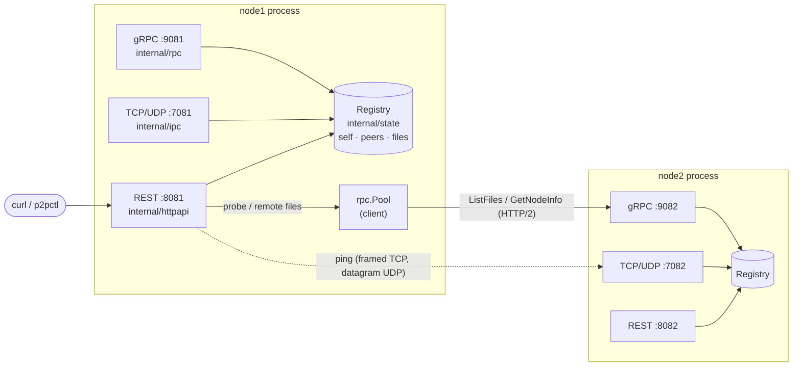

# Architecture

## CW1: two-node foundation

**One rule:** only `state.Registry` holds mutable shared data. Its methods lock internally and copy values in and out, so no other package can reach the maps.

**Lifecycle:** `node.New` binds all four listeners and releases the ones it already bound if a later one fails; `Run` serves them as components; shutdown stops them in reverse order within `ShutdownTimeout`, then closes the client pool.
